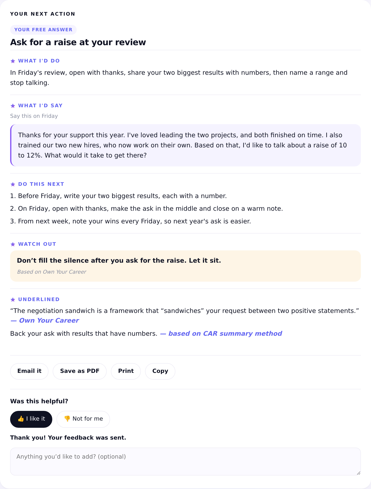
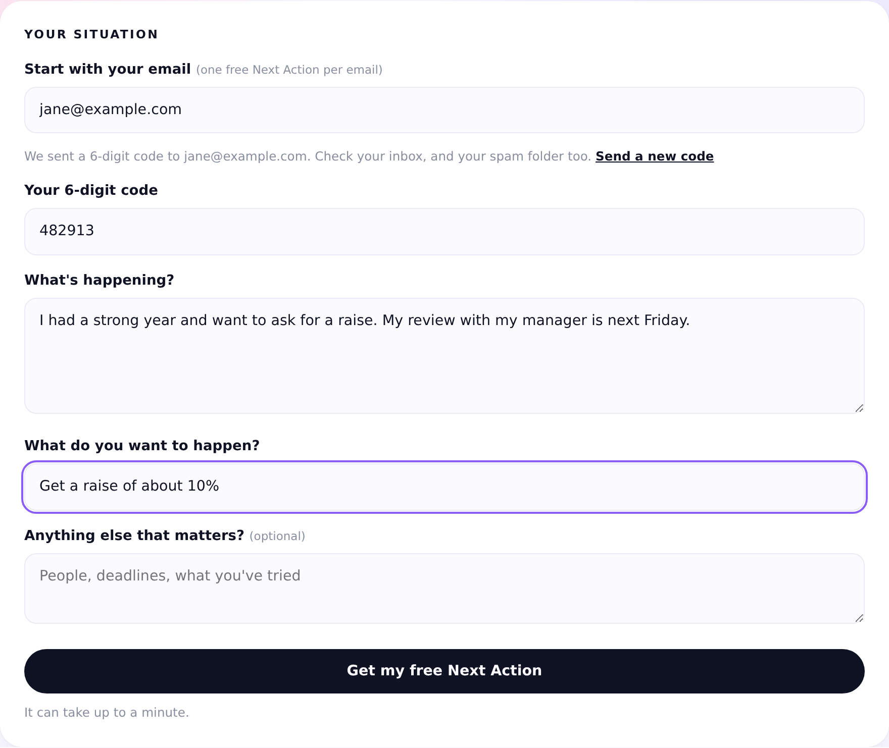
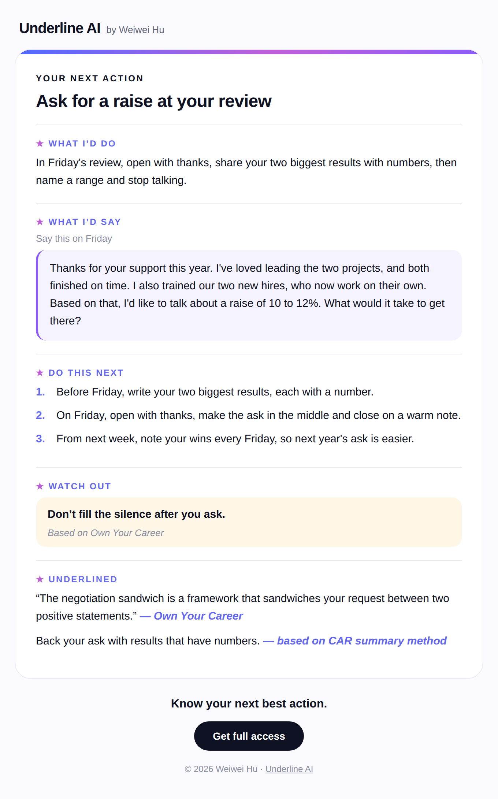

# Underline AI

**Practical advice for work and life.** By Weiwei Hu.

Bring one situation. Leave with a one-page actionable plan.

### [See Underline AI →](https://wei-wei-hu.github.io/underline-ai/) · [Free trial →](https://wei-wei-hu.github.io/underline-ai/#own)

## What it is

Underline AI is your personalized AI advisor. Bring a question, a challenge, or a decision you're stuck on, and get advice that fits your situation, all on one page.

Underline AI draws from a carefully curated library on communication, influence, negotiation, leadership, and getting work done. It brings together the most useful thinking for your situation and turns it into practical advice. You'll see what to do, what to say, and the ideas behind it.

**Topics:** Career, Communication, Leadership, Productivity, Decisions, Work-life balance.

## How it works

1. **Share your situation.** What's happening, what you want to happen, and anything else that matters.
2. **Connect the ideas.** Underline AI searches its curated library, brings together the ideas that fit your situation, and turns them into practical advice.
3. **Leave with Your Next Action.** What to do, what to say, your next steps, and the ideas behind the advice.

## Your Next Action

Every answer has the same five parts:

- **What I'd do:** the one most valuable, decisive recommendation for your situation
- **What I'd say:** the actual words to use, in a warm, human tone
- **Do this next:** three to five actions, drawn from the library and adapted to you
- **Watch out:** one trap the sources warn you to avoid
- **Underlined:** the three to five ideas behind the advice, in the authors' own words where possible, with their sources

## Ways to try it

**Examples.** The [Examples](https://wei-wei-hu.github.io/underline-ai/#try) section shows five sample answers, one for each kind of situation. Samples are free.

**Try it on your own situation.** In the [Try it](https://wei-wei-hu.github.io/underline-ai/#own) section, anyone can get one free Next Action for their own situation:

1. Enter your email and click **Email me a code**.
2. Enter the 6-digit code from your inbox, describe your situation, and click **Get my free Next Action**.
3. Your answer appears on the page in about a minute.

Each email address gets one free Next Action. After that, the page offers full access.

## Take it with you

Under every answer:

- **Email it:** sends the answer to your inbox, designed like the page
- **Save as PDF** and **Print:** a clean one-page version with the Underline AI design
- **Copy:** the answer as plain text

Free answers also ask **Was this helpful?** One tap on 👍 or 👎 sends the feedback, and you can add which part didn't work and a comment.

## Get full access

To get Your Next Action for every situation, [get full access here](https://buy.stripe.com/cNi14nfzP6RKfkX9F2eQM00). After you subscribe, I'll email you a link to get access.

## What's in this repo

| File | What it is |
|---|---|
| `index.html` | The Underline AI website, published with GitHub Pages |
| `docs/` | Cover image and screenshots used in this README |
| `LICENSE` | Terms of use |

The website talks to two small private services that are not in this repo: the Underline AI server, which writes each Next Action with Claude from the curated library, and a Google Apps Script that sends the one-time codes, keeps one free try per email, emails answers and records feedback.

## Contact

- Website: https://weiweihu.carrd.co
- GitHub: https://github.com/wei-wei-hu/underline-ai
- LinkedIn: https://www.linkedin.com/in/weiweihu/

## License

© 2026 Weiwei Hu. All rights reserved. Proprietary: no copying, reuse, redistribution or AI training without written permission. See [LICENSE](LICENSE).
