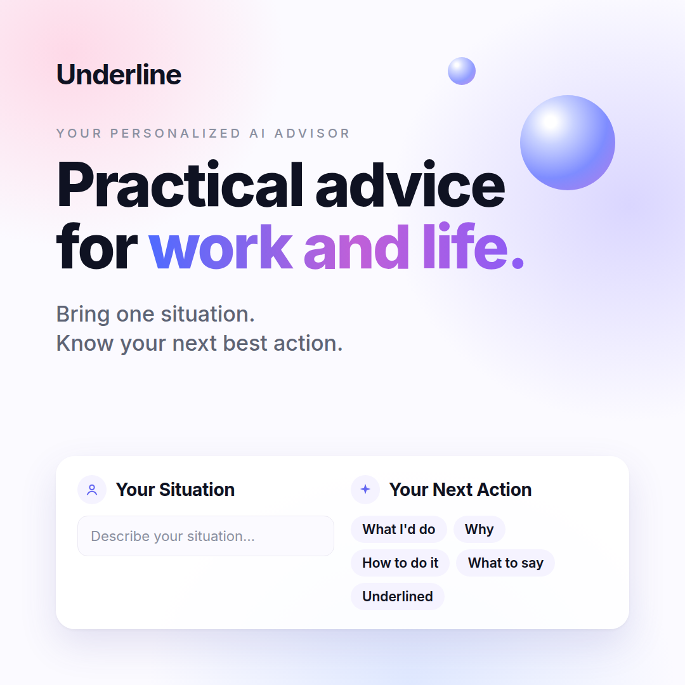
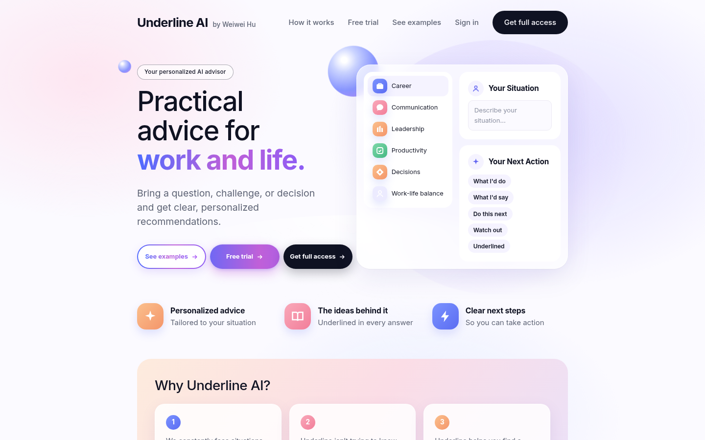
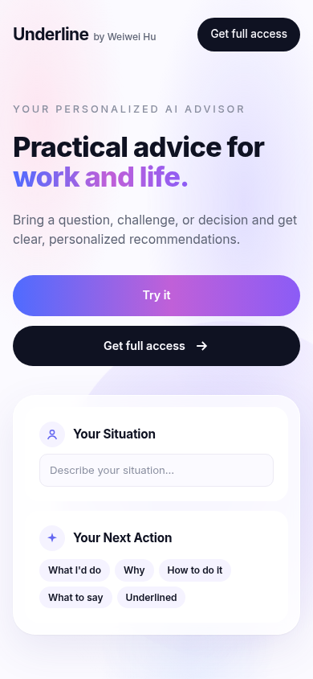

# Underline

**Practical advice for work and life.** By Weiwei Hu.

Bring one situation. Know your next best action.

### [See Underline →](https://wei-wei-hu.github.io/underline/)

## What it is

Underline is your personalized AI advisor. Bring a question, challenge, or decision and get clear, personalized recommendations on a single page.

**You share Your Situation:**

- What's happening?
- What do you want to happen?
- Anything else that matters? (optional)

**You get Your Next Action:**

- **What I'd do:** one clear recommendation
- **Why:** 2 to 3 reasons that fit your situation
- **How to do it:** 3 concrete steps
- **What to say:** the exact words to use
- **Underlined:** the ideas behind it

**Topics:** Career, Communication, Leadership, Productivity, Decisions, Work-life balance.

## See the page

## Get full access

[Get full access here](https://buy.stripe.com/cNi14nfzP6RKfkX9F2eQM00). After you subscribe, I'll email you a link to get access.

## What's in this repo

| File | What it is |
|---|---|
| `index.html` | The Underline landing page, published with GitHub Pages |
| `docs/` | Cover image and screenshots used in this README |
| `LICENSE` | Terms of use |

## Contact

- Website: https://weiweihu.carrd.co
- GitHub: https://github.com/wei-wei-hu/underline
- LinkedIn: https://www.linkedin.com/in/weiweihu/

## License

© 2026 Weiwei Hu. All rights reserved. See [LICENSE](LICENSE).
